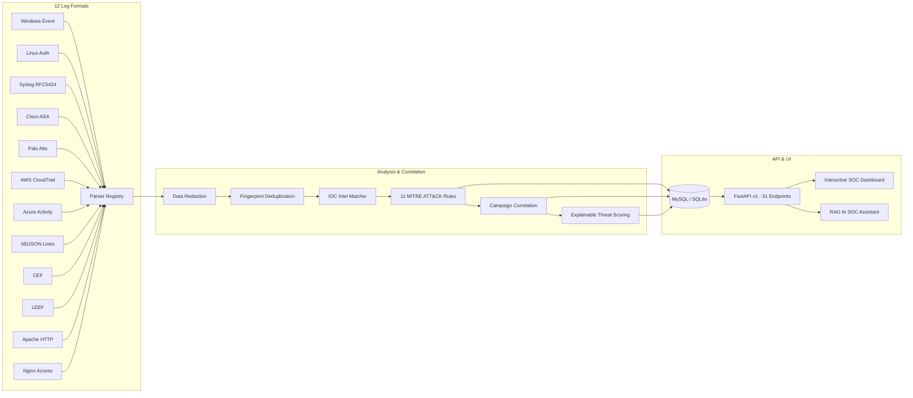

# ThreatLens — AI-Powered SIEM & Threat Detection Platform

[](https://www.python.org/)
[](https://fastapi.tiangolo.com/)
[](https://www.sqlalchemy.org/)
[](LICENSE)
[]()

**ThreatLens** is an open-source, AI-powered Security Information and Event Management (SIEM) and defensive threat detection platform. It ingests multi-source security telemetry across 12 source formats, normalizes events into an open schema, evaluates 11 deterministic MITRE ATT&CK detection rules, enriches events with Threat Intelligence (IOCs), correlates multi-stage alerts into incident campaigns, calculates explainable threat scores (0–100), and provides an AI-assisted SOC investigation workflow using Retrieval-Augmented Generation (RAG).

---

## 1. Architecture Overview



---

## 2. Core Capabilities

- **12 Log Parsers with Auto-Detection**:
  Windows Events (JSON/XML), Linux Syslog/Auth, Generic Syslog (RFC 3164 / 5424), Cisco ASA/IOS, Palo Alto Firewall (CSV), AWS CloudTrail, Azure Activity Logs, NDJSON Lines, ArcSight CEF, IBM QRadar LEEF, Apache HTTP, and Nginx Access Logs.
- **11 MITRE ATT&CK Aligned Detection Rules**:
  1. *RULE-001*: Repeated Failed Logins / Brute-Force Pattern (`T1110`)
  2. *RULE-002*: Successful Login Following a Burst of Failures (`T1110.001`)
  3. *RULE-003*: Suspicious Privileged Account or Group Change (`T1098`)
  4. *RULE-004*: New or Unusual Service/Process Execution (`T1543.003`)
  5. *RULE-005*: Suspicious PowerShell or Command-Line Indicators (`T1059.001`)
  6. *RULE-006*: Lateral Movement via Remote Logon / Admin Share (`T1021`)
  7. *RULE-007*: Unusual Outbound Connection to High-Risk Destination (`T1071`)
  8. *RULE-008*: DNS Query to Known Malicious Domain (`T1071.004`)
  9. *RULE-009*: Malware File Hash Indicator Match (`T1204`)
  10. *RULE-010*: Cloud Audit Suspicious Privilege or Policy Change (`T1098.001`)
  11. *RULE-011*: Web-Server Path Traversal or Exploit Probing (`T1190`)
- **Threat Intelligence (IOCs)**:
  Matches IPv4, IPv6, Domains, URLs, SHA-256, SHA-1, and MD5 hashes while properly distinguishing RFC 1918 internal networks.
- **Incident Campaigns & Correlation**:
  Aggregates related alerts based on shared adversary identifiers (IP, username, host, or correlation keys).
- **Explainable Threat Scoring (0–100)**:
  Every score provides transparent mathematical contributions across Severity (35%), Confidence (20%), Frequency (15%), IOC (20%), and Campaign (10%).
- **RAG SOC Assistant with Groq**:
  Answers analyst questions citing verified evidence IDs (`[ALT-...]`, `[EVT-...]`, `[IOC-...]`, `[PB-...]`), defenses against log prompt injections, and gracefully falls back to deterministic analysis when API keys are absent.
- **Interactive SOC Dashboard**:
  Built-in cybersecurity dark-mode analyst portal for real-time triage, event exploration, rule toggling, and log ingestion testing.

---

## 3. Quick Start & Setup

### Prerequisites
- Python 3.11+
- Virtual environment (`venv` or `uv`)
- Docker & Docker Compose (optional for containerized deployment)

### Local Development Setup

1. **Clone & Configure Environment**:
   ```bash
   cp .env.example .env
   ```

2. **Create & Activate Virtual Environment**:
   ```bash
   python -m venv .venv
   # Windows:
   .\.venv\Scripts\activate
   # Linux/macOS:
   source .venv/bin/activate
   ```

3. **Install Dependencies**:
   ```bash
   pip install -r requirements.txt
   ```

4. **Run Synthetic Demo Seeding**:
   ```bash
   python scripts/seed_data.py
   ```

5. **Start ThreatLens Application Server**:
   ```bash
   uvicorn app.main:app --host 0.0.0.0 --port 8000 --reload
   ```

6. **Access Interfaces**:
   - **SOC Dashboard**: [http://localhost:8000](http://localhost:8000)
   - **Interactive OpenAPI Docs**: [http://localhost:8000/docs](http://localhost:8000/docs)
   - **Health Endpoint**: [http://localhost:8000/api/v1/health](http://localhost:8000/api/v1/health)

---

## 4. Docker Deployment

Deploy full stack with MySQL 8:
```bash
docker compose up --build -d
```
Stop services:
```bash
docker compose down
```

---

## 5. Automated Testing

ThreatLens includes 44 unit and integration tests covering parsers, detection rules, IOC matching, correlation, scoring, API routes, and RAG injection defense:

```bash
pytest -v
```

---

## 6. Example API Ingestion & Investigation

### Ingesting a Raw Log (Windows Failed Logon)
```bash
curl -X POST "http://localhost:8000/api/v1/ingest/event" \
  -H "Content-Type: application/json" \
  -d '{
    "format": "windows",
    "raw_log": "{\"Event\":{\"System\":{\"EventID\":4625,\"TimeCreated\":{\"SystemTime\":\"2026-10-14T21:00:00Z\"},\"Computer\":\"DC01\"},\"EventData\":{\"TargetUserName\":\"admin\",\"IpAddress\":\"198.51.100.5\",\"IpPort\":\"54321\",\"Status\":\"0xC000006D\"}}}"
  }'
```

### Asking the AI / Deterministic SOC Analyst
```bash
curl -X POST "http://localhost:8000/api/v1/investigations/ask" \
  -H "Content-Type: application/json" \
  -d '{
    "question": "Summarize the brute-force activity from 198.51.100.5 and recommend defensive steps."
  }'
```

---

## 7. Limitations & Known Gaps

- **In-Memory Background Worker**: The default asynchronous pipeline operates an in-process queue suitable for single-node deployments. For high-volume multi-node clusters, attach a durable broker (e.g. RabbitMQ/Redis).
- **Log Formatting Variations**: Vendor-specific log formats with proprietary extensions may require format hint passing if standard RFC headers are stripped.

---

## 8. Safe Demo Usage & Security

ThreatLens is strictly a defensive SIEM platform. It contains **no offensive capabilities, exploits, or payload generation tooling**. All test scenarios utilize synthetic mock logs conforming to RFC 5737 documentation address ranges.

