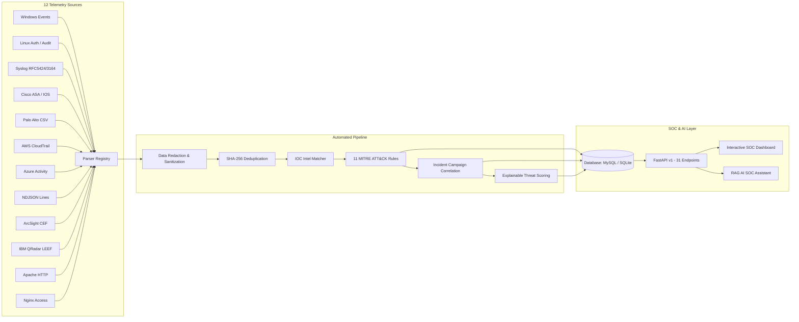

# ThreatLens — AI-Powered SIEM & Threat Detection Platform

[](https://threatlenzzz.onrender.com)
[](https://threatlenzzz.onrender.com/docs)
[](https://www.python.org/)
[](LICENSE)
[]()

> **Live Production Deployment**: [https://threatlenzzz.onrender.com](https://threatlenzzz.onrender.com)  
> **Interactive Swagger API Documentation**: [https://threatlenzzz.onrender.com/docs](https://threatlenzzz.onrender.com/docs)  
> **ReDoc API Documentation**: [https://threatlenzzz.onrender.com/redoc](https://threatlenzzz.onrender.com/redoc)

---

## 📌 Project Overview

**ThreatLens** is an open-source, enterprise-grade, AI-powered **Security Information and Event Management (SIEM)** and defensive threat intelligence platform built for modern Security Operations Centers (SOCs). 

It ingests heterogenous, multi-source security telemetry across **12 distinct log formats**, normalizes incoming events into a unified schema, performs SHA-256 fingerprint deduplication and sensitive data redaction, cross-references against Threat Intelligence (IOCs), and evaluates events against **11 deterministic MITRE ATT&CK detection rules**.

Alerts are correlated into multi-stage attack **Campaigns**, scored using an **Explainable Threat Scoring Algorithm (0–100)**, and integrated into an AI-assisted SOC investigation workflow powered by **Retrieval-Augmented Generation (RAG)** with strict evidence verification and prompt injection protection.

---

## 🚀 Live Access & Links

| Service | Link | Description |
| :--- | :--- | :--- |
| **SOC Web Dashboard** | [threatlenzzz.onrender.com](https://threatlenzzz.onrender.com) | Real-time cybersecurity analyst dashboard with live metrics, alert feeds, and ingestion sandbox |
| **Swagger UI (Interactive API)** | [threatlenzzz.onrender.com/docs](https://threatlenzzz.onrender.com/docs) | Complete interactive documentation for all 31 REST API endpoints |
| **ReDoc API Reference** | [threatlenzzz.onrender.com/redoc](https://threatlenzzz.onrender.com/redoc) | Clean, readable reference documentation of schemas and models |
| **Health Check** | [threatlenzzz.onrender.com/api/v1/health](https://threatlenzzz.onrender.com/api/v1/health) | Real-time health monitoring and environment check |
| **Dashboard Metrics API** | [threatlenzzz.onrender.com/api/v1/metrics/dashboard](https://threatlenzzz.onrender.com/api/v1/metrics/dashboard) | Live JSON aggregate metrics (total events, alerts by severity, active campaigns) |

> **Default Demo Analyst Credentials**:
> - **Username**: `soc_analyst`
> - **Password**: `ThreatLens@2026!`

---

## 🏗️ Architecture Overview



---

## ⚡ Core Features & Capabilities

### 1. 12 Telemetry Parsers with Auto-Detection
ThreatLens parses and normalizes logs from across enterprise infrastructure into an open standard event model:
- **Operating Systems**: Windows Event Logs (`4624`, `4625`, `4720`, `4728`, `4738`, `7045`), Linux `/var/log/auth.log`, `/var/log/secure`.
- **Network & Perimeter**: Cisco ASA/IOS, Palo Alto Networks Firewall (CSV traffic/threat logs).
- **Cloud Infrastructure**: AWS CloudTrail JSON, Azure Activity Log JSON.
- **Enterprise Standards**: ArcSight Common Event Format (CEF), IBM QRadar LEEF, Syslog (RFC 3164 & RFC 5424), NDJSON.
- **Web Applications**: Apache HTTP Access Logs, Nginx Combined Access Logs.

### 2. 11 Deterministic MITRE ATT&CK Detection Rules
Every rule evaluates real-time sliding windows and attaches explicit tactic/technique mappings:
1. **`RULE-001`**: Repeated Failed Logins / Brute-Force Pattern (`T1110`)
2. **`RULE-002`**: Successful Login Following a Burst of Failures (`T1110.001`)
3. **`RULE-003`**: Suspicious Privileged Account or Group Change (`T1098`)
4. **`RULE-004`**: New or Unusual Service/Process Execution (`T1543.003`)
5. **`RULE-005`**: Suspicious PowerShell or Command-Line Indicators (`T1059.001`)
6. **`RULE-006`**: Lateral Movement via Remote Logon / Admin Share (`T1021`)
7. **`RULE-007`**: Unusual Outbound Connection to High-Risk Destination (`T1071`)
8. **`RULE-008`**: DNS Query to Known Malicious Domain (`T1071.004`)
9. **`RULE-009`**: Malware File Hash Indicator Match (`T1204`)
10. **`RULE-010`**: Cloud Audit Suspicious Privilege or Policy Change (`T1098.001`)
11. **`RULE-011`**: Web-Server Path Traversal or Exploit Probing (`T1190`)

### 3. Explainable Threat Scoring Engine (0–100)
Eliminates "black box" security scores by providing an audited mathematical breakdown for every incident:
$$\text{ThreatScore} = \text{clamp}\Big(S_{\text{severity}} \times 0.35 + C_{\text{confidence}} \times 0.20 + F_{\text{frequency}} \times 0.15 + I_{\text{ioc}} \times 0.20 + K_{\text{campaign}} \times 0.10,\, 0,\, 100\Big)$$

### 4. RAG AI SOC Analyst Assistant
- Integrated with Groq's `llama3-70b-8192` high-throughput model.
- **Evidence Verification**: Enforces citations of real database IDs (`[ALT-...]`, `[EVT-...]`, `[IOC-...]`).
- **Prompt Injection Defense**: Detects and neutralizes instruction overrides embedded within ingested log payloads.
- **Deterministic Fallback Engine**: Seamlessly transitions to rule-based contextual summaries when external API keys are unavailable.

---

## 🛠️ Local Development & Quick Start

```bash
# 1. Clone the repository
git clone https://github.com/rakshit03sinha/ThreatLens.git
cd ThreatLens

# 2. Setup virtual environment
python -m venv .venv
.\.venv\Scripts\activate   # Windows
# source .venv/bin/activate # Linux / macOS

# 3. Install dependencies
pip install -r requirements.txt

# 4. Populate synthetic demo security telemetry
python scripts/seed_data.py

# 5. Run application locally
uvicorn app.main:app --host 127.0.0.1 --port 8000 --reload
```

---

## 🧪 Automated Test Suite

ThreatLens features a comprehensive automated test suite with **44 passing unit and integration tests**:

```bash
pytest -v
```
- Parsers verification (all 12 formats + auto-detection)
- Detection rules verification (MITRE ATT&CK validation + sliding windows)
- RFC 1918 internal net filtering & IOC threat intel matching
- Campaign correlation & explainable threat scoring
- RAG evidence verification & injection defense
- End-to-end API routes and error handling

---

## 🛡️ Responsible Security & Defensive Scope

ThreatLens is designed exclusively for **defensive telemetry analysis, monitoring, and threat detection**. It contains no offensive tooling, exploit payloads, or malicious automation. All test cases and seed data utilize mock network infrastructure conforming to RFC 5737 and RFC 2606 standards.
