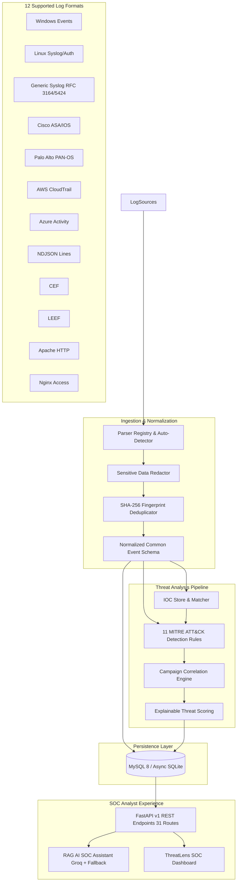

# ThreatLens Architecture Specification

ThreatLens is an enterprise-grade AI-powered SIEM (Security Information and Event Management) and defensive threat detection platform designed to ingest multi-source telemetry, normalize logs into an open common event schema, evaluate deterministic detection rules aligned with MITRE ATT&CK, enrich events with threat intelligence IOCs, correlate alerts into campaigns, compute explainable risk scores, and assist SOC analysts with Retrieval-Augmented Generation (RAG).

## Component Breakdown

### 1. Ingestion & Parser Registry
- Handles single event logs and batched payloads (up to 2,000 items per batch).
- Maintains a registry of 12 log parsers with format auto-detection.
- Evaluates record fingerprints (`SHA-256(format:timestamp:message:extra)`) to guarantee ingestion idempotency.
- Redacts sensitive authentication tokens, passwords, authorization headers, and credit card patterns before storage.

### 2. Detection Engine (11 Rules)
- Purely deterministic, MITRE ATT&CK aligned rules.
- State evaluation across configurable sliding time windows (default 300s to 600s).
- Generates `Alert` records and links each supporting `Event` as `AlertEvidence`.

### 3. IOC Store & Threat Intelligence Enrichment
- Supports IPv4, IPv6, Domains, URLs, SHA-256, SHA-1, and MD5 hashes.
- Automatically distinguishes RFC 1918 internal IP subnets from external IPs.
- Extracts hashes and queries from normalized fields and raw logs.

### 4. Correlation & Campaign Engine
- Identifies common adversary signals across alerts (shared source IP, target account, host, or correlation key).
- Links multi-stage alerts into incident `Campaign` objects.
- Dynamically increases campaign risk score as related alerts accumulate.

### 5. Explainable Threat Scoring
- Normalizes threat scores strictly between 0 and 100.
- Clamped factor breakdown:
  - Severity Weight: 35%
  - Analytic Confidence: 20%
  - Telemetry Frequency: 15%
  - IOC Intelligence Match: 20%
  - Campaign Breadth: 10%

### 6. RAG-Powered SOC Investigation
- Grounded in retrieved telemetry events, alert evidence, IOC intel, and incident playbooks.
- Strict prompt isolation: logs are treated as untrusted data, defending against prompt injection.
- Direct Groq API integration (`llama3-70b-8192`) with a robust deterministic fallback engine when API keys are absent.

